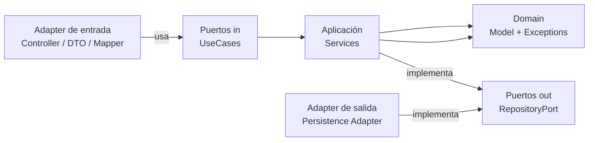

# Backend Unishare · Arquitectura Hexagonal — Estructura, Desarrollo y Seguridad

> Documento de referencia para el equipo. Define la organización de paquetes del
> backend Spring Boot, las reglas de la arquitectura hexagonal (puertos y
> adaptadores) y dónde ubicar cada pieza (incluida la seguridad), para que el
> dominio quede aislado del framework.
>
> **Nota:** este documento describe únicamente la **arquitectura**. No se crean
> clases ni entidades concretas; el código se implementará en pasos posteriores.

---

## 1. Objetivo de la arquitectura hexagonal

Separar el **núcleo de negocio** (lo que la aplicación *es*) de los detalles
técnicos (lo que la aplicación *usa*): Spring, JPA, HTTP, seguridad, base de
datos, etc.

- **Núcleo (domain + application)**: no depende de ningún framework. Es puro
  Java, fácil de testear y de entender.
- **Adaptadores (infrastructure)**: conectan el núcleo con el mundo exterior
  (web, BD, JWT). Se pueden reemplazar sin tocar el negocio.
- **Puertos**: interfaces que definen los contratos entre el núcleo y los
  adaptadores.
  - **Puertos de entrada (`in`)**: cómo se *invoca* al negocio (casos de uso).
  - **Puertos de salida (`out`)**: qué *necesita* el negocio del exterior
    (persistencia, etc.).



---

## 2. Estructura de paquetes (solo arquitectura)

```text
com.eagledev.backend
├── domain/
│   ├── model/              # entidades y objetos de valor del dominio
│   └── exception/          # excepciones propias del negocio
├── application/
│   ├── port/
│   │   ├── in/             # puertos de entrada (casos de uso)
│   │   └── out/            # puertos de salida (persistencia/externos)
│   └── service/            # implementación de los casos de uso
├── infrastructure/
│   ├── adapter/
│   │   ├── in/
│   │   │   └── web/
│   │   │       ├── controller/   # endpoints REST
│   │   │       ├── dto/          # request/response HTTP
│   │   │       └── mapper/       # DTO <-> dominio
│   │   └── out/
│   │       └── persistence/
│   │           ├── entity/       # entidades JPA
│   │           ├── repository/   # repositorios Spring Data
│   │           ├── mapper/       # JPA entity <-> dominio
│   │           └── (adaptador de persistencia)
│   ├── config/             # beans y configuraciones de Spring
│   ├── security/
│   │   └── jwt/            # filtro, generador y validador de token
│   └── exception/          # manejo global de errores HTTP
└── BackendApplication.java

src/main/resources/
├── db/migration/           # migraciones Flyway (V{n}__descripcion.sql)
└── application.yml
```

---

## 3. Responsabilidad de cada paquete

| Paquete | Responsabilidad |
|---|---|
| `domain/model` | Entidades y objetos de valor del negocio (sin anotaciones JPA/Spring). |
| `domain/exception` | Errores propios del dominio (excepciones de negocio). |
| `application/port/in` | Interfaces de casos de uso (entrada). |
| `application/port/out` | Interfaces de persistencia/externos (salida). |
| `application/service` | Implementación de los casos de uso, orquestando dominio y puertos. |
| `infrastructure/adapter/in/web/controller` | Endpoints REST; sin lógica de negocio. |
| `infrastructure/adapter/in/web/dto` | Objetos de entrada/salida HTTP. |
| `infrastructure/adapter/in/web/mapper` | Conversión DTO ↔ dominio. |
| `infrastructure/adapter/out/persistence/entity` | Entidades JPA (no son el modelo de dominio). |
| `infrastructure/adapter/out/persistence/repository` | Repositorios Spring Data. |
| `infrastructure/adapter/out/persistence/mapper` | Conversión entidad JPA ↔ dominio. |
| `infrastructure/adapter/out/persistence` | Adaptador que implementa el puerto de salida. |
| `infrastructure/config` | Beans y configuraciones de Spring. |
| `infrastructure/security/jwt` | Todo lo relacionado con JWT. |
| `infrastructure/exception` | `@RestControllerAdvice` y traducción de errores a HTTP. |

---

## 4. Reglas de dependencia (reglas de oro)

1. **`domain` no importa nada de `application` ni de `infrastructure`.** Es la
   capa más interna y no conoce Spring, JPA, HTTP ni seguridad.
2. **`application` solo importa `domain`** (y sus propios puertos).
3. **`infrastructure` importa `domain` y `application`**, y es la única capa que
   toca Spring, JPA, controladores y seguridad.
4. La dependencia va **siempre hacia adentro**; nunca al revés.
5. Los **mappers** viven en los adaptadores, no en el dominio:
   - Entrada: `web/mapper` convierte DTO ↔ dominio.
   - Salida: `persistence/mapper` convierte entidad JPA ↔ dominio.

---

## 5. Convenciones de desarrollo

- Casos de uso: `Verbo + Entidad + UseCase` (interfaz en `port/in`), con
  implementación en `service`.
- Puertos de salida: `Entidad + RepositoryPort` en `port/out`.
- Adaptadores de salida: `Entidad + PersistenceAdapter` en
  `adapter/out/persistence`.
- Entidades JPA: sufijo `JpaEntity` para no confundirlas con el modelo de dominio.
- DTOs: sufijo `Request`/`Response` en `web/dto`.
- Excepciones de dominio en `domain/exception`; el traductor a códigos HTTP
  (400, 404, 409, etc.) vive en `infrastructure/exception`.
- No usar `@Autowired` de campo; preferir inyección por constructor.
- Un controller **no** debe contener lógica de negocio: solo valida el request,
  invoca el caso de uso y devuelve el response.

---

## 6. Seguridad (qué va en cada lugar)

La seguridad es un **adaptador de entrada**: protege el acceso, pero el dominio
no debe saber que existe.

### 6.1. `infrastructure/security`
- `SecurityFilterChain` (configuración de Spring Security): reglas de rutas
  públicas/privadas, CORS, CSRF y manejo de errores 401/403.
- Beans necesarios (encoder de contraseñas, `AuthenticationManager`, etc.).

### 6.2. `infrastructure/security/jwt`
- Filtro `OncePerRequestFilter` que lee el header `Authorization: Bearer ...`,
  valida el token y carga el `SecurityContext`.
- Servicio de token (crear, extraer claims, validar firma y expiración).
- Configuración del secret/key, issuer y expiración (desde `application.yml`).

### 6.3. Flujo típico

```text
Petición HTTP
    → JwtAuthenticationFilter (valida token y autentica)
    → SecurityFilterChain (autoriza la ruta)
    → Controller (adapter in)
    → UseCase / Service (puerto in)
    → RepositoryPort (puerto out)
    → PersistenceAdapter + Spring Data Repository
    → Base de datos
```

### 6.4. Notas

- El proyecto ya trae `spring-boot-starter-security` y
  `spring-boot-starter-security-oauth2-resource-server` (útil para validar JWT).
- No filtrar seguridad dentro del dominio ni de los services: el `Principal` se
  resuelve en el adapter de entrada y solo se pasa al servicio la información
  mínima necesaria.

---

## 7. Persistencia y migraciones

- Migraciones con **Flyway** en `src/main/resources/db/migration/`.
- Nomenclatura: `V{n}__descripcion.sql` (ej. `V1__schema_inicial.sql`).
- Una vez aplicada una migración, **no se modifica**: se crea una nueva `V{n+1}`.
- Las entidades JPA van en `persistence/entity`, los repositorios Spring Data en
  `persistence/repository` y el adaptador del puerto out en `persistence`.

---

## 8. Configuración

- Archivo de configuración: `application.yml` (renombrado desde
  `application.yaml`).
- Variables pendientes de definir:
  - Conexión a base de datos (`spring.datasource.*`).
  - Flyway (`spring.flyway.*`).
  - JWT (secret, issuer, expiración).
  - CORS y rutas públicas/privadas.

---

## 9. Estado actual del esqueleto

- Directorios creados con `.gitkeep` (sin clases Java).
- `db/migration/` vacío (sin migraciones todavía).
- `application.yml` existe con solo `spring.application.name: backend`.
- Pendientes (próximos pasos, fuera del esqueleto):
  1. Configurar datasource y Flyway.
  2. Implementar el modelo, puertos, services y adaptadores de cada caso de uso.
  3. Implementar seguridad JWT.
  4. Agregar Actuator para el health check.
  5. Dockerfile, Compose y pipeline de despliegue (ver guía de despliegue).
